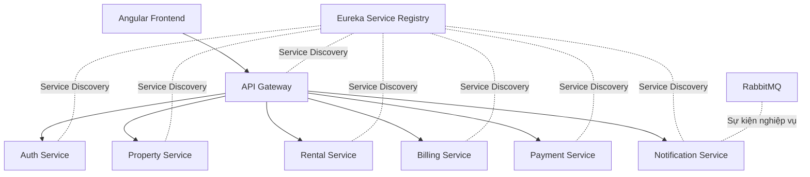

# Rental Property Management System

**Hệ thống quản lý phòng trọ theo kiến trúc hướng dịch vụ (Service-Oriented Architecture — SOA)**

Dự án xây dựng một hệ thống hỗ trợ chủ trọ quản lý nhiều khu trọ trên cùng một nền tảng: công khai thông tin phòng, quản lý nhân viên, lịch xem phòng, hồ sơ người thuê, hợp đồng, điện nước, hóa đơn, thanh toán và thông báo. Hệ thống được tổ chức thành các dịch vụ độc lập để nhóm có thể phát triển, kiểm thử và tích hợp theo từng chức năng.

> **Trạng thái dự án:** Đang phát triển theo giai đoạn. Cấu trúc và API Contract là cơ sở phối hợp của toàn nhóm; không phải mọi chức năng mô tả dưới đây đều đã được lập trình hoặc kiểm thử tích hợp.

## 1. Mục tiêu và phạm vi

- Số hóa việc quản lý nhiều khu trọ, phòng và nhân viên của **một chủ trọ (OWNER)**.
- Công khai thông tin phòng còn trống để khách có thể tìm hiểu và liên hệ chủ trọ.
- Hỗ trợ chủ trọ ghi nhận lịch xem phòng, phân công nhân viên hoặc trực tiếp dẫn khách.
- Quản lý hồ sơ người thuê, hợp đồng, tiền cọc, gia hạn và trả phòng.
- Quản lý chỉ số điện/nước, hóa đơn định kỳ, công nợ và lịch sử thanh toán.
- Hỗ trợ thanh toán mô phỏng qua môi trường sandbox và thông báo các sự kiện nghiệp vụ.
- Áp dụng SOA: chia hệ thống thành các service có trách nhiệm riêng, giao tiếp qua API Gateway, REST API và thông điệp bất đồng bộ khi phù hợp.

### Vai trò người dùng

| Vai trò | Phạm vi sử dụng |
|---|---|
| **GUEST** | Xem thông tin phòng đã công khai, xem thông tin liên hệ; không cần đăng nhập. |
| **OWNER** | Quản trị toàn hệ thống, khu trọ, nhân viên, hợp đồng, hóa đơn và thanh toán; có thể thực hiện nghiệp vụ của STAFF. |
| **STAFF** | Thực hiện các nghiệp vụ được cấp quyền tại khu trọ được phân công. |
| **TENANT** | Truy cập thông tin thuê, hợp đồng, hóa đơn, công nợ và thanh toán thuộc về mình. |

Theo phạm vi hiện tại, **GUEST liên hệ OWNER ngoài website**; OWNER ghi và phân công lịch xem phòng. Hệ thống chưa thiết kế cơ chế GUEST tự đăng ký hoặc tự đặt lịch trực tuyến.

## 2. Kiến trúc tổng quan



- **API Gateway:** Điểm truy cập API tập trung, định tuyến đến các service và xác thực JWT ở các tuyến riêng tư.
- **Service Registry (Eureka):** Đăng ký và khám phá service.
- **Các service nghiệp vụ:** Chịu trách nhiệm xử lý quy tắc nghiệp vụ và dữ liệu của phạm vi tương ứng.
- **RabbitMQ:** Hỗ trợ truyền sự kiện bất đồng bộ, trước mắt phục vụ tích hợp thông báo.
- **Cơ sở dữ liệu:** Dữ liệu thuộc service nào do service đó quản lý; không truy cập trực tiếp database của service khác.

## 3. Công nghệ sử dụng

| Thành phần | Công nghệ |
|---|---|
| Backend | Java 25, Spring Boot 4.1.1, Spring Security, Spring Data JPA |
| SOA | Spring Cloud 2025.1.3, Eureka, Spring Cloud Gateway |
| Frontend | Angular 20, TypeScript |
| Xác thực và phân quyền | JWT, RBAC (OWNER / STAFF / TENANT) |
| Cơ sở dữ liệu | MySQL; H2 in-memory dùng cho chạy thử một số service ở giai đoạn đầu |
| Message broker | RabbitMQ |
| Quản lý phụ thuộc | Maven Multi-module, npm |
| Công cụ phát triển | Spring Tools for Eclipse, VS Code, Git/GitHub, Postman, Docker Compose |

## 4. Cấu trúc repository

```text
Rental_Property_Management_System/
├── pom.xml                       # Maven Parent
├── service-registry/             # Eureka Server
├── api-gateway/                  # API Gateway
├── auth-service/                 # Tài khoản, xác thực và phân quyền
├── notification-service/         # Thông báo và tích hợp sự kiện
├── property-service/             # Khu trọ, phòng, nhân viên theo khu, lịch xem
├── rental-service/               # Người thuê, hợp đồng, tiền cọc, trả phòng
├── billing-service/              # Chỉ số điện nước, hóa đơn, công nợ
├── payment-service/              # Giao dịch thanh toán sandbox
├── frontend/                     # Angular; giao diện do cả nhóm cùng phát triển
├── database/                     # Tài nguyên và script cơ sở dữ liệu
├── docs/                         # API Contract, kiến trúc, tài liệu triển khai
├── postman/                      # Bộ request kiểm thử API
├── docker-compose.yml            # Hạ tầng local (MySQL, RabbitMQ)
├── .env.example                  # Mẫu biến môi trường, không chứa bí mật thật
├── .gitignore
└── README.md
```

**Lưu ý:** Những thư mục service mới chỉ có `.gitkeep` là vị trí dành trước cho thành viên phát triển, **chưa phải Maven module hoàn chỉnh**. Chỉ đưa service vào `<modules>` trong `pom.xml` cha khi thư mục đó đã có `pom.xml` hợp lệ.

## 5. Phân công phát triển

| Thành viên | Phụ trách chính |
|---|---|
| **Quân** | Maven Parent, Service Registry, API Gateway, Auth/User Service, Notification Service; phối hợp tích hợp và kiểm thử toàn hệ thống. |
| **Thiện** | Property Service: khu trọ, phòng, thông tin công khai, nhân viên theo khu và lịch xem phòng. |
| **Sáng** | Rental Service: hồ sơ người thuê, hợp đồng, tiền cọc, gia hạn và trả phòng. |
| **Quốc** | Billing Service và Payment Service: điện nước, hóa đơn, công nợ và thanh toán mô phỏng. |
| **Cả nhóm** | Phát triển giao diện Angular cho phần mình phụ trách; cập nhật API Contract, Postman và kiểm thử tích hợp. |

Phân công thể hiện **trách nhiệm phát triển**, không có nghĩa tất cả các module đã hoàn thành.

## 6. API và các quy ước tích hợp

- Base URL local qua Gateway: **`http://localhost:8080`**.
- Endpoint nghiệp vụ dùng **`/api/...`**, **không dùng `/api/v1/...`**.
- Các API yêu cầu đăng nhập sử dụng `Authorization: Bearer <accessToken>`.
- Dịch vụ nghiệp vụ phải kiểm tra quyền truy cập dữ liệu, không chỉ dựa vào việc Gateway đã kiểm tra JWT.
- Các service trao đổi dữ liệu qua API hoặc sự kiện, không truy cập trực tiếp bảng dữ liệu của nhau.
- Thay đổi API, DTO, phân quyền hoặc sự kiện dùng chung cần cập nhật API Contract trước khi tích hợp.

Tài liệu tham chiếu của nhóm: **[`docs/api-contract/API_CONTRACT.md`](docs/api-contract/API_CONTRACT.md)** (sau khi thêm bản API Contract dùng chung vào repository). Các endpoint ở trạng thái thiết kế chưa đồng nghĩa đã có mã nguồn.

## 7. Thiết lập môi trường phát triển

### Yêu cầu

- JDK 25 và Maven.
- Node.js và npm tương thích với Angular 20.
- Spring Tools for Eclipse (STS) hoặc IDE Java hỗ trợ Maven.
- Docker Desktop / Docker Compose nếu chạy MySQL, RabbitMQ bằng container.

### Import Maven vào Spring Tools

1. Clone repository và chuyển sang nhánh làm việc phù hợp.
2. Trong STS: **File → Import → Maven → Existing Maven Projects**.
3. Chọn thư mục gốc repository và import Maven Parent cùng các module **đã có `pom.xml`**.
4. Chọn **Maven → Update Project** để cập nhật dependency.
5. Không import các thư mục chỉ chứa `.gitkeep` như một Maven project.

### Khởi chạy môi trường local

Các cổng hiện được sử dụng trong cấu hình nền tảng:

| Thành phần | Cổng local |
|---|---|
| Eureka Server | `8761` |
| API Gateway | `8080` |
| Auth Service | `8081` |
| Notification Service | `8086` |
| Angular | `4200` |
| MySQL (khi bật Docker) | `3306` |
| RabbitMQ AMQP / Management | `5672` / `15672` |

Với phần nền tảng hiện có, khởi động lần lượt **Service Registry → Auth Service → Notification Service → API Gateway**, chọn **Run As → Spring Boot App** trong STS. Sau đó có thể mở:

- Eureka Dashboard: `http://localhost:8761`
- Gateway health: `http://localhost:8080/actuator/health`

Frontend:

```bash
cd frontend
npm install
npm start
```

Truy cập `http://localhost:4200`. Các giao diện nghiệp vụ của từng service sẽ được bổ sung và tích hợp trong quá trình phát triển.

Nếu cần MySQL và RabbitMQ:

```bash
docker compose up -d
```

Docker Compose hiện cung cấp **hạ tầng local**, không tự động khởi chạy toàn bộ Spring Boot service. Một số service dùng H2 cho demo ban đầu; cần cấu hình profile MySQL khi chuyển sang cơ sở dữ liệu MySQL.

### Biến môi trường và an toàn thông tin

Tham khảo `.env.example` để biết tên biến môi trường và thay các giá trị demo trước khi triển khai ở môi trường khác localhost. Không commit `.env`, mật khẩu, JWT secret thật, `target/` hoặc `node_modules/`.

## 8. Quy trình làm việc với Git

```text
main                          # Nhánh ổn định
  └── dev                     # Nhánh tích hợp của nhóm
        ├── feature/quan/project-setup
        ├── feature/quan/service-registry
        ├── feature/quan/api-gateway
        ├── feature/quan/auth-service
        ├── feature/quan/notification-service
        └── feature/<thanh-vien>/<chuc-nang>
```

- Mỗi thành viên phát triển trên **feature branch** của phần việc được giao.
- Tạo **Pull Request vào `dev`** để rà soát và tích hợp; không đẩy code trực tiếp lên `main` hoặc `dev`.
- Mỗi PR nên tập trung vào một chức năng, cập nhật tài liệu/API Contract nếu có thay đổi và có bằng chứng kiểm thử phù hợp.
- `feature/quan/project-setup` chỉ chứa nền tảng chung (Maven Parent, cấu trúc thư mục, `.gitignore`, README và tài liệu dùng chung); code từng service nên được commit ở nhánh tương ứng.

## 9. Tài liệu dự án

- **SRS:** Tài liệu đặc tả yêu cầu phần mềm của toàn hệ thống (lưu trong `docs/` khi được đưa lên repository).
- **API Contract:** `docs/api-contract/API_CONTRACT.md` — quy ước endpoint, request/response và phân quyền của toàn nhóm.
- **Architecture:** `docs/architecture/` — sơ đồ và quyết định thiết kế.
- **Postman:** `postman/` — kiểm thử API.
- **Hướng dẫn theo giai đoạn/module:** Đặt trong `docs/plan/`, `docs/setup/` hoặc README ở thư mục module phù hợp; **không dùng README gốc làm báo cáo tiến độ của một cá nhân**.

---

**Rental Property Management System** là sản phẩm phát triển chung của nhóm. Các chức năng sẽ được hoàn thiện và kiểm thử qua từng giai đoạn, sau đó tích hợp trên nhánh `dev`.
